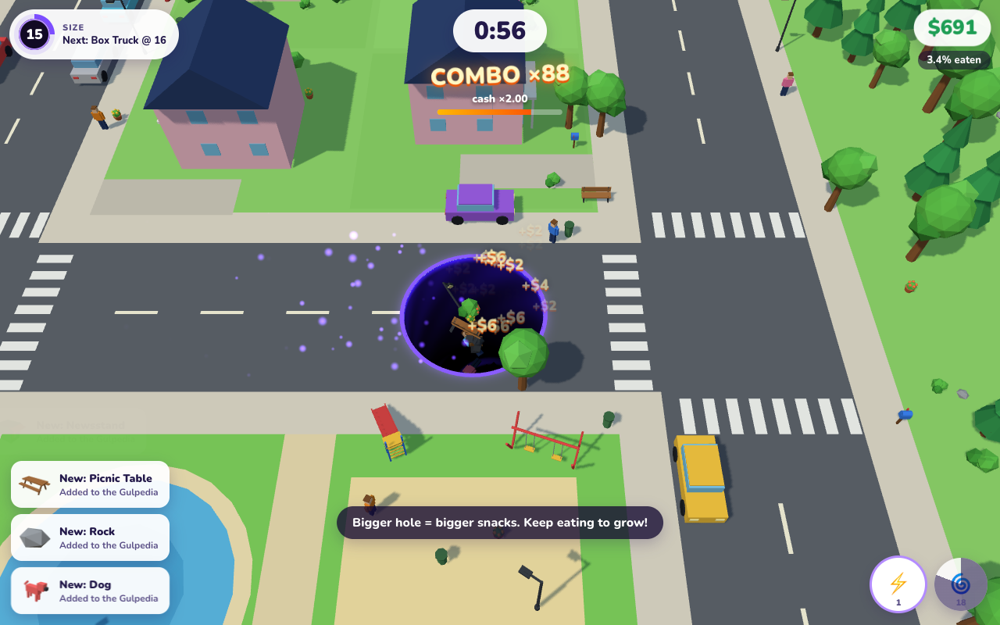

# Snack Hole

A hole roams a bright low-poly world and swallows everything smaller than itself — cones, people,
cars, houses, skyscrapers, cargo ships, jumbo jets — feeding a deep incremental meta-game.



## Run it

```bash
cd snack-hole-game
npm install
npm run dev        # http://localhost:5101
```

Other commands:

```bash
npm run build      # type-check + production build into dist/
npm run preview    # serve the build on :5101
npm test           # vitest unit tests (economy, formatting, world, map gen and ladders, save)
npm run sim        # headless balance simulation (greedy bot), prints the unlock timeline
npm run sim -- --human --runs 6 --report   # 'human' model + PASS/FAIL pacing targets (DESIGN.md)
npm run smoke      # Playwright smoke test + screenshots (starts its own dev server; needs Google Chrome)
```

## Controls

| Action | Desktop | Touch |
|---|---|---|
| Steer | Point the mouse where you want to go (distance from centre = speed), or WASD / arrows | Drag anywhere (virtual joystick) |
| Dash | Space or 1 | ⚡ button |
| Vortex | 2 | 🌀 button |
| Mega Mouth | 3 | 👄 button |
| Play from the hub | Click PLAY or press Enter | Tap PLAY |
| Settings | ⚙️ or Esc in the hub | ⚙️ |
| Pause | Esc in a round | ⏸ button |
| Debug panel (dev server only) | ` (backtick) | — |

## Features

- **Hole tech**: ground cut open by a shader (up to 8 holes), dark inner walls, animated swirl
  floor, glowing rim; props tip over the rim, slide in and fall into the dark. Too-big props
  wobble on the rim; small creatures run away.
- **6 procedural maps** (seeded): Sunny Suburb, Happy Farm, Downtown, Harbor, Airport, Moon Base —
  roads with traffic, pedestrians on sidewalks, animals in pens, boats, taxiing planes, rovers,
  hovering UFOs. 1,200–2,100 objects per map, 106 hand-modelled procedural prop types rendered
  with instancing.
- **Rounds**: 60–100 s, steady growth (~4–6 s per size level), "next snack" hints, combo
  multiplier, floating cash, level-up bursts. A round finishes early once nothing reachable is
  left (counting what you could still grow into and Mega Mouth) and pays a time bonus. Results
  screen with records and new discoveries. Golden props (x10), random events (rush hour, UFO
  fly-by, farm stampede), slow-mo landmark swallows, Esc pause.
- **Incremental layers**: 9 capped upgrade tracks (one chunky level at a time), helper holes that
  eat for you during rounds, 3 active abilities, maps unlocked by reaching a size goal (later
  ones also need Singularities), 100% clear bonuses, Singularity prestige with lifetime-based
  Dark Matter, a 7-node DM tree and endless tiers after Moon Base, 13 hole skins.
- **Collection**: Gulpedia with live 3D thumbnails and set bonuses, 42 trophies (+2% cash each).
- **Persistence**: versioned save in localStorage, autosave every 20 s and on tab close/hide,
  export / import, reset with confirmation, "While you were away" earnings (half a round of
  recent income per hour away, 8 h cap, upgradable).
- **Audio**: everything synthesised with WebAudio — size-pitched gulps, rising combo chimes,
  level-up arpeggios, fanfares, map ambience. Background music: one CC0 track per map (see
  CREDITS.md). Volume, mute, music and ambience toggles.
- **Settings**: scientific notation, shadows, screen shake, floating numbers.
- **Mobile**: responsive hub (bottom sheet), touch joystick, on-screen ability buttons.

## Debug panel

In `npm run dev` only, press **`** (backtick) at any time: add cash / Dark Matter, multiply cash,
time warp x1/x10/x100, unlock everything, +5 size in a round, end the round, simulate 2 h offline.
It also shows frame timing and economy stats. Release builds (`npm run build`) leave the panel,
its cheats and the `window.game` handle out entirely (`import.meta.env.DEV`), so `npm run smoke`
must run against the dev server.

Dev builds also take testing flags in the URL, e.g. `/?mute&fresh&seed=7`: `mute` (no audio),
`fresh` (new save, never stored), `save=midgame` (fixture save, never stored) and `seed=N` (fixed
world seed). See `src/dev/flags.ts`.

Release output (`dist/`, ~7.3 MB): app JS 187 KB and three.js 544 KB in separate chunks
(64 + 135 KB gzipped; serve with gzip or brotli), CSS 21 KB, one Latin Nunito font (39 KB) and
six 96 kbps music tracks (5.5 MB, fetched only for the map being played).

## Project layout

See [DESIGN.md](DESIGN.md) for the economy formulas, pacing table and architecture, and
[CREDITS.md](CREDITS.md) for third-party code and fonts. Balance numbers live in
`src/config/balance.ts`.
